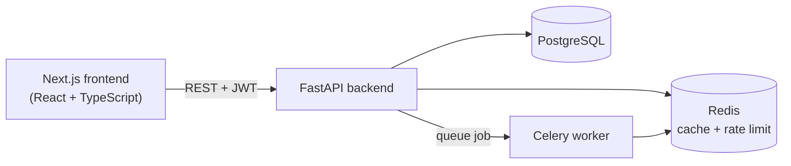

# LearnSphere - Student Learning Platform

A full-stack learning platform where instructors build courses and students
enroll, learn lesson by lesson, take quizzes, track their progress and earn
**publicly verifiable certificates**.

**Stack:** Next.js (React, TypeScript) - FastAPI (Python) - PostgreSQL - Redis - Celery - Docker - GitHub Actions

<!-- Add a screenshot or GIF here:  -->
<!-- Add your live demo link here once deployed. -->

---

## Features

**Students**
- Sign up / log in (JWT), browse and search the course catalog
- Enroll, read lessons, mark them complete, see a live progress bar
- Take multiple-choice quizzes (answers are never sent to the browser) and see attempt history
- Earn a certificate automatically once **every lesson is completed and every quiz is passed**
- Share a public certificate page that anyone can use to verify it

**Instructors / admins**
- Instructor studio to create courses, modules, lessons (with optional video link) and quizzes
- Edit or delete only their own courses (admins can manage any course)

**Platform**
- Role-based access control (`student`, `instructor`, `admin`)
- Lessons and quiz questions are visible only to enrolled students and the course owner
- Redis caching for the course list, Celery worker for certificate notifications
- Rate limiting on login / register, request IDs in logs, health check endpoint

---

## Architecture



**Request flow (example: marking a lesson complete)**
1. The lesson page calls `POST /api/v1/progress/lessons/{id}/complete` with the JWT.
2. A dependency decodes the token and loads the user (401 if invalid or expired).
3. The route checks the student is enrolled (403 otherwise) and saves the progress row.
4. `issue_certificate_if_eligible` checks all lessons and quizzes; if satisfied it creates a certificate
   (a database unique constraint prevents duplicates) and queues a Celery notification job.
5. The response returns the new progress and, when earned, the certificate number.

### Project structure

```
backend/
  app/
    api/         deps.py (auth dependencies) and routes/ (HTTP layer, thin)
    services/    business logic: quiz scoring, progress, certificates, cache, permissions
    models/      SQLAlchemy tables
    schemas/     Pydantic request/response models and validation
    core/        settings, security (JWT, hashing), rate limiting
    exceptions/  consistent JSON error format
  alembic/       database migrations
  scripts/       manage.py -> seed demo data, promote users
  tests/         pytest suite (each test runs in a rolled-back transaction)
frontend/
  app/           Next.js pages (courses, lessons, quizzes, dashboard, instructor, verify)
  components/    Navbar, ProgressBar
  lib/           API client, auth helpers, useFetch hook, shared types
docker-compose.yml   db + redis + backend + celery worker + frontend
.github/workflows/   CI: backend migrations + tests, frontend lint + build
```

---

## Run it with Docker (easiest)

```bash
cp .env.example .env          # then edit POSTGRES_PASSWORD and JWT_SECRET_KEY
docker compose up --build
docker compose exec backend python -m scripts.manage seed   # demo data
```

- App: http://localhost:3000
- API docs (Swagger): http://localhost:8000/docs
- Health: http://localhost:8000/health

The backend container applies database migrations automatically on start.

### Demo accounts (created by the seed command)

| Role | Email | Password |
|---|---|---|
| Admin | admin@example.com | DemoPass123! |
| Instructor | instructor@example.com | DemoPass123! |
| Student | student@example.com | DemoPass123! |

Public sign-up always creates a **student**. Promote a real account with:
`python -m scripts.manage set-role you@example.com instructor`

## Run it locally (without Docker for the app)

```bash
# 1. Database + Redis only
docker compose up -d db redis

# 2. Backend
cd backend
python -m venv venv && source venv/bin/activate      # Windows: venv\Scripts\activate
pip install -r requirements-dev.txt
cp .env.example .env     # make the password in DATABASE_URL match POSTGRES_PASSWORD
alembic upgrade head
python -m scripts.manage seed
uvicorn app.main:app --reload

# optional: background worker (add --pool=solo on Windows)
celery -A app.worker.celery_app worker --loglevel=info

# 3. Frontend (new terminal)
cd frontend
cp .env.example .env.local
npm ci
npm run dev
```

## Tests

```bash
cd backend
pytest -q          # needs PostgreSQL + Redis running and `alembic upgrade head` applied
```

The suite covers authentication (including expired / forged tokens), role and
ownership checks, enrollment, progress, quiz scoring, certificate rules
(no duplicates, issued in either order), caching, rate limiting and the public
verification endpoint. Every test runs inside a transaction that is rolled
back, so the database stays clean.

Frontend: `cd frontend && npm run lint && npm run build`.

---

## API overview (`/api/v1`)

| Area | Endpoints |
|---|---|
| Auth | `POST /auth/register`, `POST /auth/login`, `GET /auth/me` |
| Courses | `GET /courses` (pagination + search), `GET /courses/mine`, `GET /courses/{id}`, `GET /courses/{id}/outline`, `POST`, `PUT`, `DELETE` |
| Content | `POST /courses/{id}/modules`, `POST /modules/{id}/lessons`, `GET /lessons/{id}` (enrolled only) |
| Learning | `POST /enrollments/courses/{id}`, `GET /enrollments`, `POST /progress/lessons/{id}/complete`, `GET /progress/courses/{id}` |
| Quizzes | `POST /quizzes/courses/{id}`, `POST /quizzes/{id}/questions`, `GET /quizzes/{id}/questions`, `POST /quizzes/{id}/submit`, `GET /quizzes/{id}/attempts` |
| Certificates | `GET /certificates`, `GET /certificates/verify/{number}` (public) |

Full interactive docs are at `/docs` when the API is running.

---

## Design decisions (good interview material)

- **Services layer for business rules.** Routes stay thin; scoring and certificate rules live in
  `services/`, so they are unit-testable (`quiz_service` is pure Python with no database).
- **Correctness enforced by the database, not only by code.** Unique constraints stop duplicate
  enrollments, progress rows and certificates even when two requests race; the code handles the
  resulting `IntegrityError` gracefully.
- **Quiz scoring counts each question once.** Duplicate answers in one submission can not inflate the score.
- **Answer keys never leave the server.** `QuestionResponse` has no `correct_answer` field.
- **Fail-open infrastructure.** If Redis is down, caching and rate limiting are skipped instead of taking the API down;
  `/health` reports `503` so monitoring still notices.
- **Safe by default.** Passwords hashed with Argon2, JWTs expire, CORS origins and secrets come from environment
  variables, the app refuses to start in production with a weak JWT secret, lesson text is rendered as plain
  text (no HTML injection) and video links must be `http(s)`.
- **Lessons gated by enrollment**, while the syllabus (titles only) stays public so visitors can see what a course offers.

## Known limitations / ideas for next steps

- The access token is stored in `localStorage` (simple, but exposed to XSS). A production hardening step is an
  `HttpOnly` cookie plus refresh tokens.
- The course catalog loads up to 100 courses and filters in the browser; very large catalogs should use the
  server-side `q`, `skip` and `limit` parameters the API already supports.
- Certificate notifications are logged by the worker; plug in an email provider (SendGrid / SES / SMTP) in
  `app/worker.py`.
- Behind a reverse proxy, run uvicorn with `--proxy-headers` so rate limiting sees real client IPs.
- Possible features: instructor analytics, course reviews, PDF certificate download, file uploads.

## License

MIT - see [LICENSE](LICENSE).
